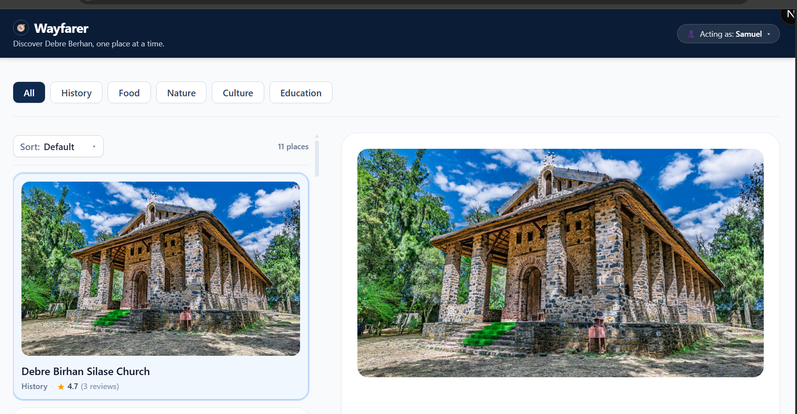
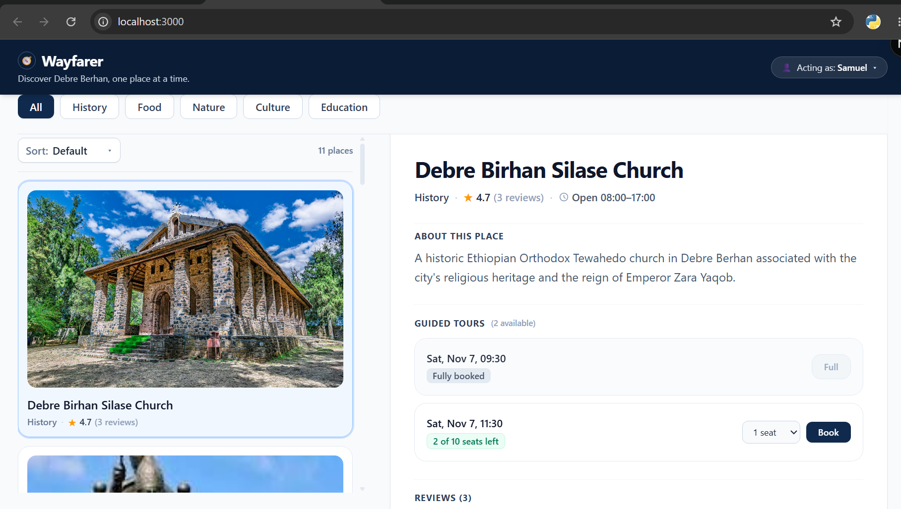
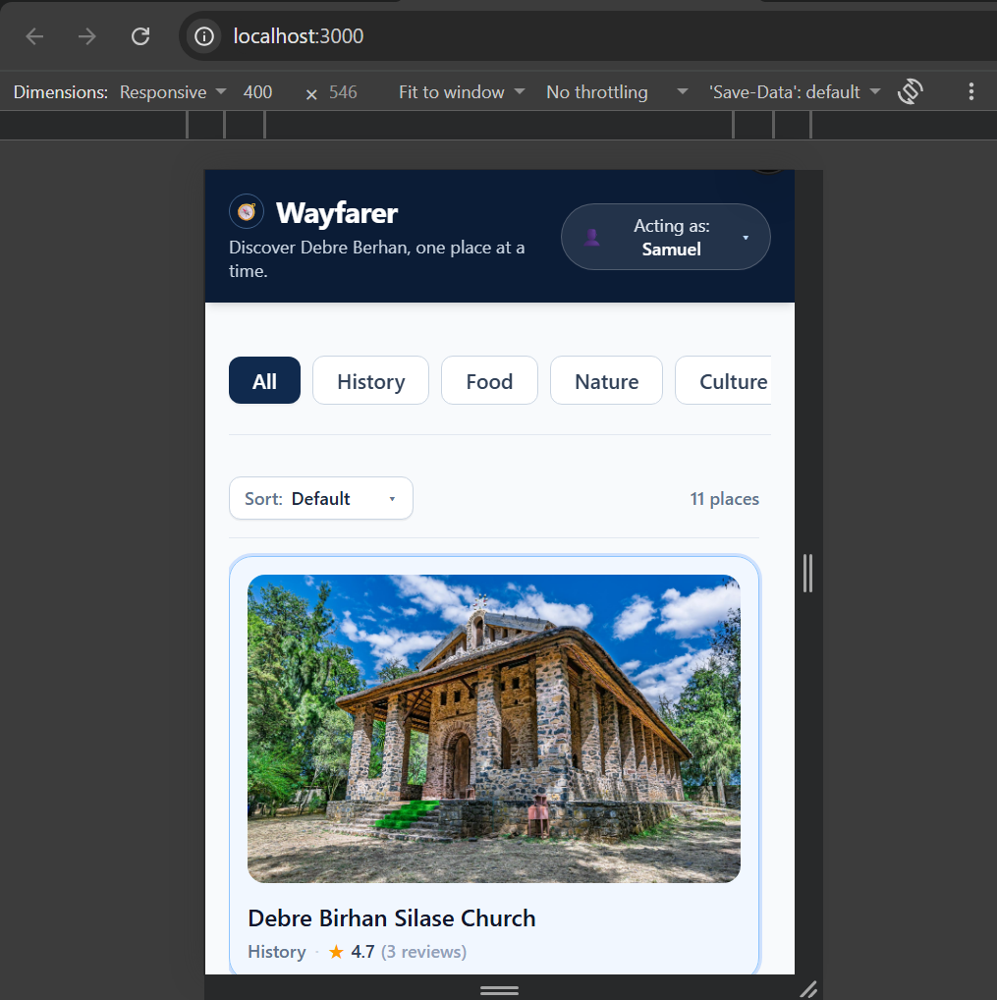
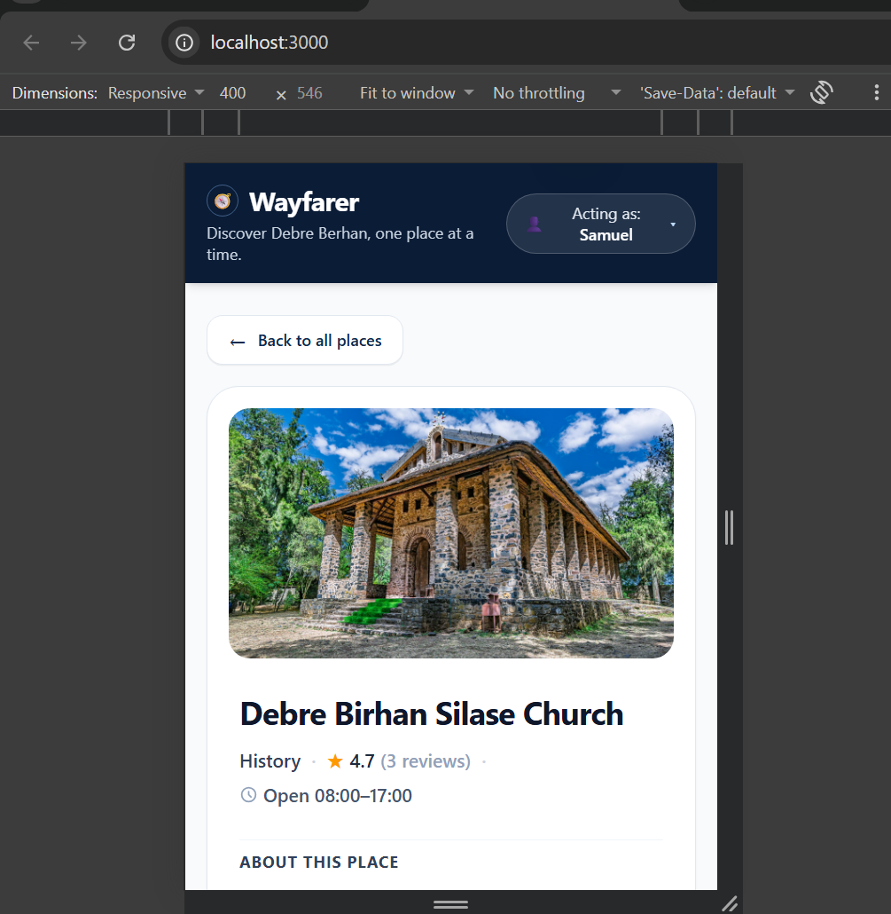

# Wayfarer 🧭

Wayfarer is a full-stack city discovery and guided tour booking app for **Debre Berhan, Ethiopia**. It lets travellers explore authentic destinations, read and submit community reviews, and reserve tour seats—engineered with honest Bayesian review rankings and concurrency-safe bookings.

---

## 📸 Screenshots

### Desktop Discovery & Tour Booking

*Desktop master-detail view with category filtering, Bayesian top-rated sorting, horizontal tour slots carousel, and reviews.*

### Tour Slots, Booking & Reviews Detail

*Place detail panel featuring interactive seat booking, live capacity checks, and honest user reviews.*

### Mobile Adaptive Experience
<p align="center">
  
  &nbsp;&nbsp;&nbsp;&nbsp;
  
</p>
<p align="center">
  <em>Left: Mobile places directory with sticky filters. Right: Instant place detail view with "← Back to all places" navigation.</em>
</p>

---

## ⚡ Quickstart Setup & Run

### Option 1: Docker (Recommended — zero configuration)
```bash
# 1. Start a local PostgreSQL container
docker compose up -d

# 2. Install dependencies, apply database schema & seed data
npm run setup

# 3. Start both frontend (:3000) and backend (:4000)
npm run dev
```

### Option 2: Existing Local PostgreSQL
```bash
# 1. If your credentials differ from postgres:postgres@localhost:5432,
#    create backend/.env (from backend/.env.example) and set your DATABASE_URL:
#    DATABASE_URL="postgresql://<user>:<password>@localhost:<port>/wayfarer_db"

# 2. Install dependencies, apply database schema & seed data
npm run setup

# 3. Start development servers
npm run dev
```

Open **[http://localhost:3000](http://localhost:3000)** in your browser.

---

## 🧪 How to Run Tests (1 Command)

Run all unit and integration tests across the entire application:
```bash
npm test
```

### Optional Granular Test Commands
```bash
npm run test:unit         # Pure mathematical & business logic tests (Bayesian ranking)
npm run test:integration  # Real database concurrency tests (pessimistic row locking)
```

---

## ⚠️ Known Limitations & Future Improvements

1. **Simulated Authentication:** User identity is managed through the acting-as switcher and `X-User-Id` request header, as specified in the assignment. This is intended for demonstration, not production security. A production system would require authentication and server-side authorization.

2. **Single-City Scope:** The application is currently designed around Debre Berhan and its seeded places. Supporting multiple cities would require additional location management, city-based filtering, and broader search capabilities.

3. **Tour Booking Management:** Users can create and update bookings, but booking cancellation and associated seat-release workflows are not implemented. These could be added with appropriate booking status management and transaction handling.

4. **Real-Time Availability:** Available seats are refreshed after booking operations, but changes made by other users are not automatically pushed to already-open browser sessions. WebSockets or Server-Sent Events could provide live updates if required.

5. **Static Place Images:** Place images are maintained as frontend static assets, with their paths stored in the database. Dynamic image uploads and management could be introduced using object storage if the application needed user-managed content.

6. **Rating Aggregation at Scale:** The Bayesian ranking calculation currently aggregates review data from PostgreSQL when retrieving places. For significantly larger datasets or higher traffic, precomputed rating statistics or caching could reduce repeated database work.
